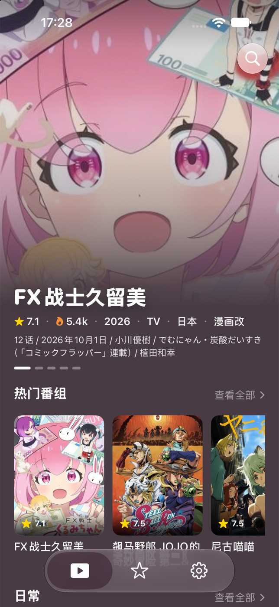

# Tube

原生 iPhone、iPad 和 Mac 视频播放器，基于 [Cezzu](https://github.com/bentx2685/cezzu) 的 MIT 开源代码开发。保留完整核心功能，以 Tube 名称、独立应用标识和规则订阅发布。

首版构建与验证结果见 [验证记录](docs/VALIDATION.md)。



## 功能

- Bangumi 搜索、推荐、番剧详情、评分与标签。
- 本地追番收藏、观看历史与断点续播。
- 多视频源、线路与剧集切换，订阅和导入兼容 Kazumi / Cezzu 的规则。
- AVPlayer 播放、倍速、后台音频、iOS 画中画与 AirPlay。
- DanDanPlay 弹幕及字号、透明度、区域、密度等设置。
- MetalFX / Anime4K 视频超分辨率（受设备和播放方式限制）。
- iPhone 底部导航、iPad 自适应布局、Mac 原生窗口和播放快捷键。
- 深浅色主题；iOS 26 / macOS 26 起启用 Liquid Glass，旧系统回退到 Material。

最低支持 **iOS 17 / macOS 14**。无登录、无自建后端；收藏与历史保存在本机，当前不提供 iCloud 同步。视频源、Bangumi 和弹幕的可用性取决于第三方服务及网络。

## 开发与运行

需要 macOS、Xcode 26+（Swift 6.2+）和 [XcodeGen](https://github.com/yonaskolb/XcodeGen)：

```bash
brew install xcodegen
git clone https://github.com/nembx/tube.git
cd tube
bash scripts/build.sh project
open app/Tube.xcodeproj
```

在 Xcode 选择 `Tube-iOS` 或 `Tube-macOS` scheme 后运行。iPhone / iPad 真机运行需要在 Signing & Capabilities 选择自己的开发团队。模拟器和本地 Mac 构建无需开发者证书。

```bash
bash scripts/build.sh test       # 核心测试
bash scripts/build.sh macos      # 可在本机运行的 Mac .app
bash scripts/build.sh simulator  # iOS 模拟器 .app
bash scripts/build.sh ios        # iPhone / iPad 未签名 IPA
```

构建脚本自动使用 `/Applications/Xcode.app`，不修改系统 `xcode-select`。可通过 `DEVELOPER_DIR` 和 `XCODEGEN` 指定工具路径。

输出：

| 平台 | 产物 |
| --- | --- |
| Mac | `artifacts/macos/Build/Products/Release/Tube.app` |
| iOS 模拟器 | `artifacts/simulator/Build/Products/Debug-iphonesimulator/Tube.app` |
| iPhone / iPad | `artifacts/Tube-ios-unsigned.ipa`，安装前需自行签名 |

Mac 产物仅做本地 ad-hoc 签名，未公证；面向其他用户分发需 Developer ID 签名和公证。App Store / TestFlight 发布需使用自己的 Apple Developer 账号归档上传。

## 弹幕凭证

仓库不包含 DanDanPlay AppID / AppSecret。可在「设置 → DanDanPlay 凭证」填入自己申请的凭证，或复制 `app/LocalSecrets.example.xcconfig` 为 `app/LocalSecrets.xcconfig` 后填写。后者已被 Git 忽略。未配置时仍可使用搜索、收藏和视频播放，在线弹幕无法正常拉取。

## 工程结构

```text
app/project.yml       XcodeGen 工程定义
app/Tube-iOS/         iPhone / iPad 入口与资源
app/Tube-macOS/       Mac 入口与资源
app/CezzuKit/         共享 SwiftUI、播放、规则、存储及测试
cezzu-rule/           内置规则与订阅索引
vendor/Anime4K/       着色器来源及许可证
scripts/             工程生成、构建、版本及图标脚本
```

共享库保留 `CezzuKit` 名称，便于追溯来源与合并上游更新。`app/project.yml` 为工程配置来源，生成的 `.xcodeproj` 不入库。版本统一由 `version.json` 管理。

默认规则订阅指向本仓库 `main/cezzu-rule/`，也保留可选 ghfast 镜像；内置规则随应用打包，首次启动无需下载规则清单。规则内容继承自上游，第三方站点是否可播放需以实际访问为准。

## 来源与许可

基于 Cezzu commit `d8b55708eab84676ef5d668da14d2119f7f6772a`。Tube 改动包括应用名称、包标识、图标、仓库入口、默认订阅与构建流程。上游完整 MIT 版权声明保存在 [LICENSE](LICENSE)，更多组件信息见 [THIRD_PARTY_NOTICES.md](THIRD_PARTY_NOTICES.md)。

感谢 Cezzu、Kazumi / KazumiRules、Kanna、Anime4K、Bangumi 和 DanDanPlay。应用本身不提供视频内容，请使用有权访问的来源。
